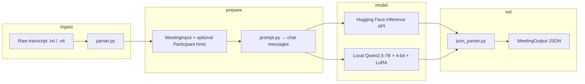

# Meeting Attribution Notes

Turn messy meeting exports into **who said what**, a short summary, and **action items with clear owners**—even when the transcript only says `Speaker 1` / `Speaker 2` or mixes Zoom/Teams WebVTT quirks.

Fine-tuned **Qwen2.5-7B-Instruct** (LoRA) outputs structured JSON: per-line speaker attribution with confidence, reasoning, bullets, and directed action items. A small **Streamlit** app and CLI scripts wrap the same pipeline used at inference time.

---

## Problem & approach

| Challenge | What this repo does |
|-----------|---------------------|
| Generic diarization labels (`Speaker N`) | Uses dialogue cues (“Hey Bob…”), optional role/department hints, and VTT labels where present |
| Zoom vs Teams caption formats | Dedicated WebVTT parser (timestamps, Teams name-on-own-line layout, unlabeled cues) |
| Unstructured notes | Constrains the model to a **Pydantic** schema via prompts + fine-tuning on gold JSON |

**Inference-first design:** `src/prompt.py` builds the same chat messages for production and for SFT (`src/training_data.py`), so behavior in the app matches what the adapter was trained on.

---

## How it works



1. **Parse** — `parse_meeting_text()` detects VTT vs plain text and yields `TranscriptLine` rows (`raw_label`, `text`).
2. **Prompt** — System + user messages include title, participants, lines, and an output schema hint.
3. **Generate** — Default backend: Hugging Face chat completion (`backend="hf"`). Optional local path loads base weights + LoRA with 4-bit quantization.
4. **Validate** — `parse_meeting_output()` strips fences/extra text and validates `MeetingOutput`.

---

## Model & fine-tuning

Details below are taken from this repository only (weights and full training recipe may live outside the tree).

| Item | Value in code |
|------|----------------|
| Base model | [`Qwen/Qwen2.5-7B-Instruct`](https://huggingface.co/Qwen/Qwen2.5-7B-Instruct) (`BASE_MODEL` in `src/inference.py`) |
| Default hosted endpoint | `Qwen/Qwen2.5-7B-Instruct:featherless-ai` |
| Adapter layout (local) | `models/meeting-attribution-lora/` (gitignored; see setup) |
| Local load | `PeftModel` on 4-bit NF4 weights (`BitsAndBytesConfig`: `bnb_4bit_quant_type="nf4"`, `bnb_4bit_compute_dtype=bfloat16`) |
| Training data | `data/train/meeting_examples.jsonl` — **9** input/output pairs |
| SFT message format | `row_to_messages()` — system/user from `build_system_prompt()` / `build_user_prompt()`, assistant = gold `output` JSON |
| Train stack (not in default `requirements.txt`) | `requirements-train.txt`: `transformers`, `peft`, `trl`, `datasets`, `accelerate`, `bitsandbytes` (comment: *Training-only deps (Colab)*) |

**Not in this repo:** a checked-in training script, LoRA rank/alpha/target-module config, or published eval metrics. See [Evaluation](#evaluation) to run the bundled check yourself.

---

## Evaluation

There are **no committed benchmark numbers** in the repo (CI runs unit tests only). Run evals locally and save the JSON report yourself.

### Single regression case

`data/eval/alice_bob_q3.json` runs against `data/sample_transcript.txt` and checks line count, speaker order, summary bullets, and action-item keywords.

```bash
cp .env.example .env   # set HF_TOKEN
python3 scripts/run_eval.py
python3 scripts/run_eval.py --backend local --adapter-path models/meeting-attribution-lora
```

### Base vs LoRA speaker attribution

Held-out suite: `data/eval/speaker_attribution_held_out.jsonl` — three gold-labeled meetings (indices 6–8 from `data/train/meeting_examples.jsonl`: incident hotfix, unlabeled VTT design review, Acme SSO). Metrics: **per-line speaker accuracy** (case-insensitive exact match) and **macro-averaged per-speaker F1**.

| Variant | What it runs |
|---------|----------------|
| `base` | HF Inference API — `Qwen/Qwen2.5-7B-Instruct` (no adapter) |
| `lora_hf` | HF API — default `Qwen/Qwen2.5-7B-Instruct:featherless-ai` endpoint |
| `lora_local` | Local 4-bit base + LoRA under `models/meeting-attribution-lora/` |

**Prerequisites**

1. `HF_TOKEN` in `.env` for `base` / `lora_hf`
2. LoRA adapter on disk for `lora_local` (see setup below)
3. NVIDIA GPU + `pip install -r requirements-train.txt` for `lora_local` (7B 4-bit; ~8 GB+ VRAM typical)

**Commands**

```bash
# Regenerate held-out JSONL from training indices 6,7,8 if needed
python3 scripts/compare_base_vs_lora.py --write-held-out

# Compare base (HF) vs local LoRA; write reproducible report
python3 scripts/compare_base_vs_lora.py \
  --variants base,lora_local \
  --adapter-path models/meeting-attribution-lora \
  --output-json results/speaker_compare_report.json

# Optional: include hosted fine-tuned endpoint
python3 scripts/compare_base_vs_lora.py --variants base,lora_hf,lora_local \
  --output-json results/speaker_compare_report.json
```

The script prints mean line accuracy and mean macro F1, plus platform/GPU metadata in the JSON (`command`, `dataset`, `timestamp_utc`).

Implementation: `src/speaker_eval.py`, `src/speaker_metrics.py`, `scripts/compare_base_vs_lora.py`.

---

## Setup

**Requirements:** Python 3.12+ (CI uses 3.13). A [Hugging Face token](https://huggingface.co/settings/tokens) for the default API backend.

```bash
python3 -m venv .venv
source .venv/bin/activate
pip install -r requirements.txt
cp .env.example .env
# Edit .env and set HF_TOKEN=...
```

**Local LoRA (optional):**

```bash
pip install -r requirements-train.txt   # torch/transformers/peft stack
# Unzip adapter weights into the repo (not distributed via git):
#   models/meeting-attribution-lora/
# Or set LORA_ADAPTER_PATH to your adapter directory.
```

**Tests:**

```bash
pip install pytest
python3 -m pytest tests/ -v
```

---

## Usage

### Streamlit UI

```bash
streamlit run app.py
```

Upload or paste a transcript, optionally add participant hints, and compare original vs attributed lines side by side.

### CLI demo

```bash
python3 scripts/run_demo.py
```

Uses `data/sample_transcript.txt` with Alice/Bob participant hints and prints attribution, summary, and action items.

### Python API

```python
from pathlib import Path
from src.parser import parse_meeting_text
from src.inference import run_meeting_analysis
from src.schemas import Participant

raw = Path("data/sample_transcript.txt").read_text(encoding="utf-8")
meeting = parse_meeting_text(
    raw,
    participants=[
        Participant(name="Alice McAliceFace", role="design", department="product"),
        Participant(name="Bob McBobFace", role="finance", department="finance"),
    ],
)
result = run_meeting_analysis(meeting)  # backend="hf" by default
# result.attributed_lines, result.summary_bullets, result.action_items
```

---

## Example input & output

**Input** (`data/sample_transcript.txt`):

```text
Sync with Alice and Bob

Speaker 1: Hey Bob, how's the budget looking for Q3?
Speaker 2: Tight. Alice, can the design team pause new hires?
Speaker 1: Only if finance signs off on the runway numbers.
Speaker 2: Fair. I'll send the spreadsheet after this call.
```

**Output shape** (field names from `src/schemas.py`; values from training gold in `meeting_examples.jsonl`, not a live model run):

```json
{
  "attributed_lines": [
    {
      "text": "Hey Bob, how's the budget looking for Q3?",
      "speaker_name": "Alice McAliceFace",
      "confidence": 0.95,
      "reasoning": "Addresses Bob; participant hints place Alice in design/product."
    }
  ],
  "summary_bullets": [
    "Finance and design aligned on a possible Q3 hiring pause."
  ],
  "action_items": [
    "Bob McBobFace: Send spreadsheet to Alice after the call."
  ]
}
```

Sample exports for other formats: `data/sample_transcript_zoom.txt`, `data/sample_transcript_teams.txt`, `data/sample_transcript_challenge_vtt.txt`.

---

## Tech stack

- **Python** — `pydantic` schemas, `python-dotenv`
- **LLM** — Hugging Face Inference API (`huggingface_hub.InferenceClient`) or local `transformers` + `peft`
- **UI** — Streamlit (`app.py`, synced comparison in `src/compare_view.py`)
- **CI** — GitHub Actions: `pytest` on push/PR to `main` (`.github/workflows/ci.yml`)

---

## Limitations

- **Small SFT set (9 examples)** — strong on demo-style finance/design dialogues; generalization to long or adversarial meetings is untested in-repo.
- **Adapter weights not in git** — you need the LoRA bundle (or HF API) to run inference; README does not ship download URLs.
- **Teams speaker-line heuristic** — `_looks_like_speaker_name_line()` can misclassify short dialogue as a name (or vice versa).
- **Line alignment** — the UI warns if the model returns a different number of attributed lines than parsed input rows.
- **API latency & cost** — default path calls a remote chat endpoint; local GPU inference requires the train stack and VRAM for 7B 4-bit.
- **No meeting sentiment** — output schema is attribution, summary, and action items only (the previous one-line README mentioned sentiment; that is not implemented).

---

## Possible next steps

- Check in or link the Colab/SFT training notebook and LoRA hyperparameters  
- Expand `data/train/meeting_examples.jsonl` and add eval cases beyond `alice_bob_q3`  
- Document where to obtain `meeting-attribution-lora.zip`  
- Optional: batch CLI, export to Markdown/Notion, or confidence-based human review queue  

---

## Project layout

| Path | Role |
|------|------|
| `src/parser.py` | Plain + WebVTT transcript parsing |
| `src/prompt.py` | System/user prompts |
| `src/inference.py` | HF API + local LoRA inference |
| `src/json_parser.py` | Robust JSON extraction from model text |
| `src/training_data.py` | JSONL → SFT chat messages |
| `src/eval_runner.py` | Single-case regression scoring |
| `src/speaker_eval.py` | Held-out speaker attribution eval |
| `scripts/compare_base_vs_lora.py` | Base vs LoRA comparison CLI |
| `app.py` | Streamlit demo |
| `data/train/meeting_examples.jsonl` | Fine-tuning examples |
| `data/eval/` | Regression fixtures |

---

## Author

Portfolio project by **Craig** — end-to-end LLM fine-tuning, structured generation, and pragmatic transcript tooling for real meeting exports.